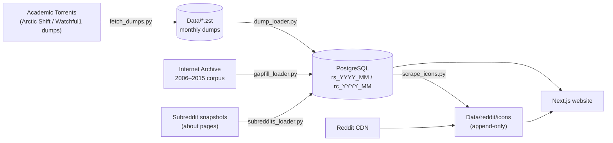

## Rebuilding Reddit
https://redditrebuilt.com/ (Might be down, not hosted often)

Reddit Rebuilt is a self-hosted archive of Reddit: every post, comment and subreddit captured in the public Pushshift / [Arctic Shift](https://github.com/ArthurHeitmann/arctic_shift) dumps, from Reddit's launch in June 2005 to the newest published month. The archive is built from those dumps, so it also keeps everything users, moderators and Reddit later deleted.

The website copies Reddit's current interface:

- **Home feed**: posts for any date range sorted by Top, Controversial, Most comments, New or Old, with infinite scroll and a "browse by year" sidebar
- **Communities** (`/r/<name>`): banner, icon, description, sidebar text, member count and the community's posts in the same sorts, including communities that were later banned or made private
- **Threads** (`/Thread/<id>`): full post, markdown, images, YouTube embeds, NSFW/spoiler blurring and threaded comments sorted by Top, New, Old or Controversial
- **User pages** (`/User/<name>`): every archived post by an account, in any of the feed sorts
- **Search**: community autocomplete across every subreddit in the archive
- **Controversial** is estimated: the dumps have no downvotes, so posts rank by how many comments they drew for their net score. Comments use the controversiality flag Reddit recorded
- **Dark mode**, mobile layout and Reddit-style URLs: swap `reddit.com` for the site's domain in any `/r/<sub>/comments/<id>/…`, `/u/<name>` or `/user/<name>` link and it opens the archived copy

## How it works



Everything runs as three Docker containers defined in `reddit-clone/docker-compose.yml`:

| Service | Container | What it does |
| --- | --- | --- |
| `db` | `reddit-rebuilt-db` | PostgreSQL 15. One table per month (`rs_2008_01` for submissions, `rc_2008_01` for comments) plus small lookup tables the site reads |
| `loader` | `reddit-data-loader` | Downloads, loads and maintains the archive; repeats daily |
| `reddit-clone` | `reddit-rebuilt-app` | The website (Next.js, served on port 3001) |

### The loader

The loader keeps the archive complete without supervision. Each cycle (every `REFRESH_HOURS`, default 24):

1. **Fetch** (`fetch_dumps.py`): reads Arctic Shift's [download list](https://github.com/ArthurHeitmann/arctic_shift/blob/master/download_links.md) to find the newest published month, then downloads every monthly dump that is neither on disk nor already loaded. Only the needed files inside each torrent are fetched. Single-month torrents are preferred, falling back to the 2005–2025 bundle. Downloads land in `Data/.downloads` and move into `Data/` only once complete.
2. **Load** (`dump_loader.py`): streams each `RS_YYYY-MM.zst` / `RC_YYYY-MM.zst` straight out of zstd (nothing is decompressed to disk) and `COPY`s it into a staging table:
   - columns are the union of keys over a sample of records, so one unusual record can't drop a column;
   - a chunk that fails is bisected, so only the bad rows are skipped;
   - indexes are built, the table is made crash-safe (`SET LOGGED`), then swapped in atomically, so the site never shows a half-loaded month;
   - completed files are recorded in `loader_state`, so an interrupted run resumes where it stopped. Several months load in parallel.
3. **Fill gaps** (`gapfill_loader.py`, once): adds posts that the monthly dumps lack from the [Full Reddit Submission Corpus (2006 thru August 2015)](https://archive.org/details/FullRedditSubmissionCorpus2006ThruAugust2015), Jason Baumgartner's original 2014–15 crawl (42.7 GB, ~200 million posts). Pushshift later re-collected those years after some communities had been banned, so the monthly dumps cut, for example, the communities banned in 2015 off at the end of 2013. The corpus is downloaded in the background and checked against its published SHA-256; then only posts whose id isn't archived in any month are added. They're kept in `rs_extra` and merged into their months, and merged again if a month is ever reloaded. Communities banned for sexualising minors or for non-consensual images (`GAPFILL_EXCLUDE`) are never added. A report of what was recovered is written to `Data/supplements/RS_full_corpus.report.json`. `python3 gapfill_loader.py check` is a dry run that only counts what would be recovered (`RS_full_corpus.check.json`).
4. **Refresh lookup tables** (`scripts/site_tables.sql`, `scripts/build_subreddit_metadata.sql`): per-month id ranges, post counts per subreddit and month, each month's top 1000 posts, and the subreddit search index. With these, a thread lookup touches one month instead of hundreds, community feeds skip months where the community had no posts, and unfiltered "Top" pages read a small table.
5. **Subreddits** (`subreddits_loader.py`): loads the about page of every subreddit (title, description, sidebar, members, creation date, icon and banner URLs) from Arctic Shift's subreddit snapshots (2024-01 and 2025-01, about 22 million communities; `u_` profile subreddits are skipped). Newer snapshots win, but a value that later disappeared, such as the icon of a since-banned community, keeps its last known version.
6. **Icons** (`scrape_icons.py`): downloads each community's icon into `Data/reddit/icons/`, starting with the communities that have the most posts. It is **append-only**: an icon already on disk is never replaced or removed, so a community deleted from Reddit keeps the icon scraped while it existed. Failed downloads are retried after 30 days.

Everything is resumable. Stopping the containers, rebooting or killing a load mid-month loses nothing: the next cycle picks up where it stopped.

## Setup

### Requirements

- Docker with Compose
- Disk space. The archive is large: the database takes roughly 2–3× the size of the compressed dumps:

| Data (2005-06 → 2026-08) | Rows | Database size, site columns | Database size, all fields |
| --- | --- | --- | --- |
| Submissions | ~3.6 billion | ~2.5–3 TB | ~7 TB |
| Comments | ~28 billion | ~3.3× the `.zst` size, ~10 TB | ~15 TB |
| Compressed dumps (downloads) | | ~1.2 TB posts, ~3 TB comments | |

Submissions and comments are loaded with the columns the website uses. Comments load oldest month first until the disk would drop below `LOADER_MIN_FREE_GB`; the months that don't fit wait on disk and load on a later run once there is room.

### Running it

```bash
git clone https://github.com/notasquid1938/Rebuilding-Reddit.git
cd Rebuilding-Reddit/reddit-clone
docker compose up -d --build
```

The site is at http://localhost:3001 and fills in month by month as the loader works. Follow progress with:

```bash
docker logs -f reddit-data-loader
```

Directories next to `reddit-clone/`:

| Path | Contents |
| --- | --- |
| `Data/` | Downloaded `.zst` dumps, subreddit snapshots (`Data/subreddits/`), the gap-fill corpus (`Data/supplements/`) and icons (`Data/reddit/icons/`) |
| `pg_archive/` | Postgres tablespace for loaded months. Point this volume at your largest disk in `docker-compose.yml` |

The Postgres data volume itself (Docker volume `postgres_data`) holds the small lookup tables and any months loaded before the tablespace existed.

### Configuration

Set these on the `loader` service in `docker-compose.yml`:

| Variable | Default | Purpose |
| --- | --- | --- |
| `LOAD_COMMENTS` | `1` | `0` loads submissions only |
| `FETCH_COMMENTS` | `0` | `1` also downloads comment months that aren't on disk (`0` loads only the ones already there) |
| `LOADER_MIN_FREE_GB` | `100` | A month only loads if the disk keeps this much free throughout; the rest wait for a later run (unset or `0` disables the check) |
| `LOADER_COLUMNS` | `site` | `site` keeps only the fields the website shows (about ⅓ the size); `all` keeps every field in the dumps |
| `DELETE_LOADED_DUMPS` | `submissions,comments` | Kinds whose `.zst` is deleted after a load with zero skipped rows, to save space |
| `LOADER_WORKERS` | `4` | Months loaded in parallel |
| `LOADER_TABLESPACE` | `archive_hdd` | Tablespace for loaded months (created on the `pg_archive` volume) |
| `GAPFILL` | `1` | `0` skips the 2006–2015 gap-fill corpus |
| `GAPFILL_EXCLUDE` | `jailbait,preteen_girls,creepshots,thefappening,beatingwomen` | Communities the gap-fill never adds (comma list, replaces the default) |
| `REFRESH_HOURS` | `24` | How often to check for newly published months |
| `ICON_RATE` | `20` | Icon downloads per second |

And on the `reddit-clone` (website) service:

| Variable | Default | Purpose |
| --- | --- | --- |
| `POSTGRES_URL` | `postgres://postgres:postgres@db:5432/Reddit-Rebuilt` | Database connection |
| `DATA_DIR` | `/Data` | Where icons (`reddit/icons/`) and archived Imgur images (`imgur/images/`) are read from |
| `SITE_URL` | `https://redditrebuilt.com` | Absolute URLs in the sitemap and canonical links |

## Database layout

| Table | Contents |
| --- | --- |
| `rs_YYYY_MM` | Submissions for one month. Indexed by `id`, `(subreddit, score)`, `(author, created_utc)` and `score` |
| `rc_YYYY_MM` | Comments for one month. Indexed by `parent_id` and `link_id` |
| `loader_state` | Every dump file loaded, with row and skipped-row counts |
| `rs_extra` | Posts recovered by the gap-fill, with their month; merged into `rs_YYYY_MM` |
| `post_id_ranges` | Base-36 id range of each month, for thread lookups |
| `subreddit_monthly` | Posts per subreddit per month |
| `top_posts` | Top 1000 posts of each month |
| `subreddits_metadata` | Per-subreddit totals and first/last active month (search, community stats) |
| `subreddit_about` | About pages: title, descriptions, members, creation date, icon/banner URLs |
| `icon_fetch_attempts` | Icon download results, so dead URLs aren't retried every cycle |

The website copes with months whose dumps lack a column (it reads them as empty), so months loaded with different loader versions or column settings can sit side by side.

## Development

```bash
cd reddit-clone
npm install
POSTGRES_URL=postgres://postgres:postgres@<db-host>:5432/Reddit-Rebuilt npm run dev
```

The site is a Next.js (Pages Router) app: pages in `pages/`, API routes in `pages/api/`, and shared database code in `lib/submissions.js`. See [reddit-clone/README.md](reddit-clone/README.md) for the code layout and maintenance scripts.

### Tests

Every pull request runs the full suite on GitHub Actions (`.github/workflows/ci.yml`). To run it locally from `reddit-clone/`:

```bash
npm test                 # JavaScript unit tests (Vitest)
npm run test:python      # loader unit tests (pytest; needs pytest, psycopg2, requests and numpy)
npm run test:integration # everything below, against a throwaway database
```

The integration run generates a miniature archive (`tests/fixtures/build_fixtures.py`), loads it into an empty `*_test` database with the real loaders, checks the result, then builds and starts the website and runs the Playwright API and browser tests (`tests/e2e/`) on desktop and mobile. Last, it runs the gap-fill on a miniature corpus and checks what it added. Without `POSTGRES_HOST` it starts its own `postgres:15` container; it refuses to touch a database whose name doesn't end in `_test`. Locally, `PW_CHANNEL=chrome` uses an installed Chrome instead of running `npx playwright install chromium`.

## Long Term Goals
- [x] Switch the database from MongoDB to PostgreSQL, so that anyone using *all* of Reddit's data doesn't hit a database bottleneck
- [x] Keep the archive current automatically: the loader follows Arctic Shift's monthly releases
- [x] A list of every subreddit ever, with about pages and icons, without the `u_` profile subreddits: built from Arctic Shift's subreddit snapshots (22M communities) with an append-only icon archive
- [ ] Load every comment (~28 billion), which needs about 9 TB more storage
- [ ] Rebuild Imgur using [Archive Team's Backups](https://archive.org/details/archiveteam_imgur) so that most image posts on Reddit stay viewable. Schema analysis suggests ~20% of all Reddit posts used an Imgur image, so it matters, even though the storage needed is enormous (746TB). The site already serves images from `Data/imgur/images/` when they're present and falls back to Imgur otherwise; `Data/imgur/` has the extraction scripts.

## Credits

The data comes from the Pushshift archives as redistributed and extended by [Watchful1](https://github.com/Watchful1/PushshiftDumps) and [RaiderBDev / Arctic Shift](https://github.com/ArthurHeitmann/arctic_shift), via [Academic Torrents](https://academictorrents.com/), with gaps in 2006–2015 filled from Jason Baumgartner's original corpus on the [Internet Archive](https://archive.org/details/FullRedditSubmissionCorpus2006ThruAugust2015). Reddit Rebuilt is an independent, non-commercial project, not affiliated with Reddit, Inc. Licensed under the GNU GPL v3.
